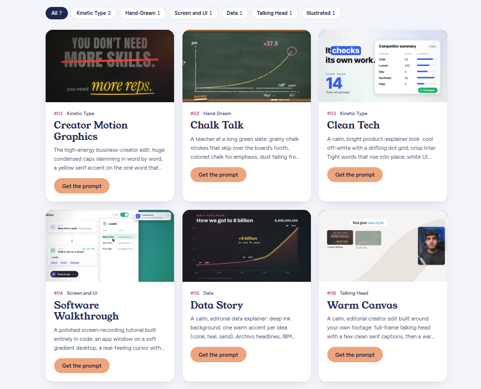

# Prompt Motion Studio

An interactive video style showcase and prompt generator for motion graphics, Remotion, and code-driven explainers. Customize topics, voiceover preferences, and storyboards with instant click-to-copy prompts.



---

## Live URL Access

- **Live Web App**: [https://ais-pre-ujno5mc7onlmwyekfs7d7x-121236562609.asia-southeast1.run.app](https://ais-pre-ujno5mc7onlmwyekfs7d7x-121236562609.asia-southeast1.run.app)
- You can access this application directly from any browser on phone, tablet, or desktop.

---

## Features

- **7 Motion Design Templates**:
  - `#01 Kinetic Type - Creator Motion Graphics`
  - `#02 Hand-Drawn - Chalk Talk`
  - `#03 Kinetic Type - Clean Tech`
  - `#04 Screen and UI - Software Walkthrough`
  - `#05 Data - Data Story`
  - `#06 Talking Head - Warm Canvas`
  - `#07 Illustrated - Isometric World`
- **Dynamic Category Filtering & Search**:
  - Filter pills dynamically calculate style counts.
  - Live search by title, description, or keyword.
- **Customizable Prompt Popup Modal**:
  - Enter custom topics or scripts.
  - Toggle between **No voiceover** (pure SFX and visual mix) and **With voiceover** (spoken narration script and timing cues).
  - Checkbox for **Storyboard First** (instructs Claude to sketch beat still frames before generating code).
  - **Previous** and **Next** buttons for rapid browsing between templates.
  - **Click-to-Copy** button with animated checkmark and visual confirmation.
  - Expandable **Live Prompt Preview** drawer.
- **Full Prompt Template Manager**:
  - **Add new styles**: Create custom motion styles with custom titles, categories, and tags.
  - **Delete styles**: Remove styles you no longer need.
  - **Edit prompt blueprints**: Customize the exact prompt template strings and dynamic placeholders (`{{topic}}`, `{{howItExplains}}`, `{{audioDirection}}`, `{{storyboardProtocol}}`).
  - **JSON Mode**: Import and export your entire prompt library.
  - **Persistent Storage**: Changes are automatically saved in `localStorage`.

---

## Local Development

1. **Clone the repository**:
   ```bash
   git clone https://github.com/<your-username>/<your-repo-name>.git
   cd <your-repo-name>
   ```

2. **Install dependencies**:
   ```bash
   npm install
   ```

3. **Start local dev server**:
   ```bash
   npm run dev
   ```
   Open `http://localhost:3000` in your browser.

4. **Build for production**:
   ```bash
   npm run build
   ```

---

## How to Publish to GitHub & Get a Free Live URL

### Step 1: Initialize Git and Push to GitHub

1. Create a new repository on [GitHub](https://github.com/new) (e.g. `prompt-motion-studio`).
2. Run the following commands in your project terminal:
   ```bash
   git init
   git add .
   git commit -m "Initial commit: Prompt Motion Studio"
   git branch -M main
   git remote add origin https://github.com/<your-username>/<your-repo-name>.git
   git push -u origin main
   ```

---

### Step 2: Choose a Free Hosting Provider

#### Option A: GitHub Pages (100% Free, Automated)
This project includes a pre-configured GitHub Actions workflow in `.github/workflows/deploy.yml`.

1. Go to your repository on GitHub.
2. Click **Settings** &rarr; **Pages** (in the left sidebar).
3. Under **Build and deployment** &rarr; **Source**, select **GitHub Actions**.
4. Push any commit to `main`, and GitHub will automatically build and publish your site at:
   ```
   https://<your-username>.github.io/<your-repo-name>/
   ```

#### Option B: Vercel (100% Free, Fastest)
1. Go to [vercel.com](https://vercel.com) and log in with your GitHub account.
2. Click **Add New Project** and select your GitHub repository.
3. Keep the default settings (Framework preset: Vite).
4. Click **Deploy**.
5. Within 30 seconds you will get a free production URL:
   ```
   https://your-project.vercel.app
   ```

#### Option C: Netlify (100% Free)
1. Go to [netlify.com](https://netlify.com) and click **Add new site** &rarr; **Import an existing project**.
2. Connect your GitHub repository.
3. Build command: `npm run build`, Publish directory: `dist`.
4. Click **Deploy site** to get your free URL:
   ```
   https://your-project.netlify.app
   ```

---

## License

Apache-2.0
